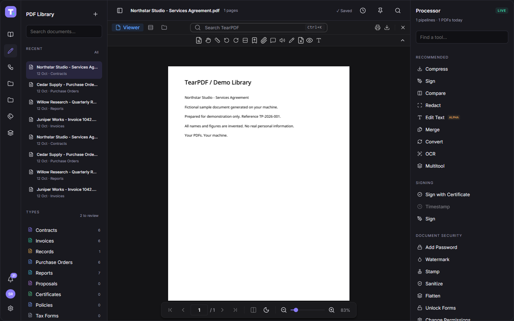

# TearPDF

**Your PDFs. Your machine.** A private PDF workspace with a local document library, three-pane editor and reusable automation pipelines.



TearPDF serves its React interface and Spring Boot API from one local process. Documents, extracted text, versions, jobs and notifications stay in a SQLite library on your machine. Fonts, icons and viewer engines are bundled. Timestamping is off until you explicitly configure a server.

- Import PDFs, detect duplicates, search extracted text, edit types and tags, pin documents and restore versions.
- Read and annotate PDFs with the existing PDFium viewer; use the free PDF tool panels for conversion, redaction, compression, signing, page operations and more.
- Chain supported tools, run jobs on documents or folders, watch folders and review job history.
- Switch dark/light/system themes, configure local processing preferences and optionally lock app access with a passcode.
- Generate fictional demo documents locally with **Settings → Load demo library**.

See [verification and limitations](docs/VERIFICATION.md) for exactly what was tested, what requires external local engines and which requested features remain incomplete. This is a personal workspace, not a multi-user service.

## Run without Docker

Use Node.js 24 and a **Java 25 JDK**. Set `JAVA_HOME` and make sure `java -version` reports 25. Dependency installation and the initial build need internet access; ordinary use does not.

```powershell
$env:PUPPETEER_SKIP_DOWNLOAD = 'true'
cd frontend
npm ci
npm run build
cd ..
.\gradlew.bat :tearpdf:bootJar --no-daemon
& "$env:JAVA_HOME\bin\java.exe" -Xmx2g -jar app/core/build/libs/TearPDF.jar
```

Open **http://127.0.0.1:8080**. Run from the repository directory so the persistent library stays in `data/library`. On macOS/Linux, use `./gradlew` and `java` with the same arguments.

Install Tesseract and OCRmyPDF for OCR, LibreOffice for office conversions, and Ghostscript, QPDF and ImageMagick for tools that need those engines. Engine availability is checked at startup. Only installed OCR language packs can be selected. Java-only tools work without them.

## Run with Docker

```sh
docker compose up --build -d
```

The recipe installs common local engines, English and Hindi OCR packs. It publishes port 8080 on loopback and persists the library and settings in named volumes. Mount `./documents` through `/documents` for folder processing. Docker was unavailable on the development machine, so this recipe has not been executed; see the verification report before relying on it.

## Develop and test

```powershell
cd frontend
npm run dev
# In a second terminal, from the repository root:
.\gradlew.bat :tearpdf:bootRun --no-daemon
```

The development UI uses http://127.0.0.1:5173 and proxies the API locally.

```powershell
cd frontend
npm run typecheck
npm test
cd ..
.\gradlew.bat :common:test :tearpdf:test --no-daemon
node scripts/smoke-tools.mjs
```

The smoke script expects a running local backend and writes fictional outputs under ignored `.internal/smoke/`. Generate bundled notices after dependency changes with `:tearpdf:writeRuntimeDependencies`, then `python scripts/generate-licenses.py`, then rebuild the frontend and backend. After changing font binaries, first run `scripts/generate-font-notices.py` with Python `fonttools` and `brotli` installed; the full license texts are already bundled and that script works offline.

## Structure

| Path | Purpose |
| --- | --- |
| `app/core` | API, PDF tools, workspace services and persistent jobs |
| `app/common` | Shared PDF and engine utilities |
| `frontend/editor/src/core/workspace` | Workspace frame, themes, library and automation UI |
| `plugins/hello` | Working compiled example tool |
| `data/library` | Ignored local SQLite database and immutable PDF objects |
| `docs` | Architecture, tool guide, screenshots and verification |

Read [architecture](docs/ARCHITECTURE.md) and [adding tools](docs/ADDING_TOOLS.md). Back up `data/library` while the app is stopped. The optional app lock controls API access; it does not encrypt stored PDFs. Keep original documents separately.

## Acknowledgements

TearPDF is based on Stirling-PDF (https://github.com/Stirling-Tools/Stirling-PDF), revision `313794c573df5e92d2f020f5ec53d08b264d6e4f`. Only the source covered by its free MIT grant was imported; the nine excluded proprietary, hosted, desktop and engine trees were omitted after approval.

The original [LICENSE](LICENSE), including `Copyright (c) 2025 Stirling PDF Inc.`, is preserved without changes. TearPDF copyright is recorded separately in [COPYRIGHT](COPYRIGHT). Original attribution and dependency notices are available in the app's **Licenses** page. Some external MIT library coordinates and Java namespaces retain their published names because they identify separately compiled dependencies; the verification report records this branding exception.
