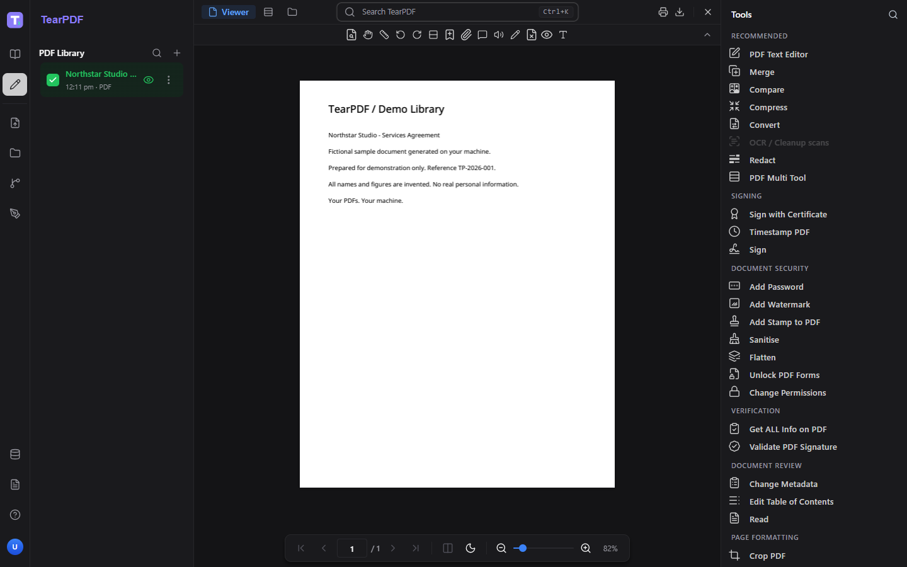

<div align="center">

# TearPDF

**Your PDFs. Your machine.**  
A private, offline-first PDF workspace combining an audited desktop-grade tool suite with a persistent local SQLite library and automation engine.

[](LICENSE)
[](https://openjdk.org/projects/jdk/25/)
[](frontend)
[](app)
[](#features)
[](#privacy--security)

<br />



</div>

---

## Overview

TearPDF operates as a unified, self-contained local process serving a React/TypeScript interface and Spring Boot backend. Documents, extracted text, immutable version objects, automated pipelines, and notifications reside exclusively in an on-disk SQLite library on your local machine.

- **Zero Outbound Telemetry**: No tracking, analytics, CDN dependencies, or runtime update pings. Fonts, icons, and PDF engines are bundled locally.
- **Audited Interface**: The default UI preserves the battle-tested reader, editor, file manager, and tool workflows with clean TearPDF branding.
- **Local Library & Automation**: A dedicated workspace at `/local-workspace` provides SQLite indexing, FTS5 full-text search, folder watching, version history, and sequential tool pipelines.
- **Engine Extensibility**: Works out-of-the-box for pure Java PDF operations; seamlessly hooks into local engines (Tesseract, OCRmyPDF, LibreOffice, Ghostscript, QPDF, ImageMagick) when installed.

---

## Features

| Capability | Details |
| :--- | :--- |
| **PDF Operations** | Reader, editor, PDFium viewer, annotations, page manipulation, compression, split/merge, redaction, digital signatures. |
| **Document Indexing** | Local SQLite storage with FTS5 full-text search, SHA-256 deduplication, classification tagging, and document pinning. |
| **Version Control** | Append-only immutable PDF object versions (`data/library/objects/<sha256>.pdf`) with instant historical restoration. |
| **Pipeline Automation** | Multi-step tool chaining, automated folder watching with stable-size debounce, batch processing, and execution audit logs. |
| **Security & Privacy** | Loopback binding by default, local Content Security Policy, PBKDF2 passcode app-lock, zero cloud phone-home. |

---

## Quickstart

### Prerequisites

- **Java**: OpenJDK 25 (`java -version` reporting 25, `JAVA_HOME` set)
- **Node.js**: v24+ & npm
- *(Optional)* External CLI engines for specialized conversions: `tesseract`, `ocrmypdf`, `libreoffice`, `ghostscript`, `qpdf`, `imagemagick`.

### Native Run

#### Windows (PowerShell)
```powershell
# 1. Build frontend bundle
$env:PUPPETEER_SKIP_DOWNLOAD = 'true'
cd frontend
npm ci
npm run build
cd ..

# 2. Package & launch backend
.\gradlew.bat :tearpdf:bootJar --no-daemon
& "$env:JAVA_HOME\bin\java.exe" -Xmx2g -jar app/core/build/libs/TearPDF.jar
```

#### macOS / Linux (Bash)
```bash
# 1. Build frontend bundle
export PUPPETEER_SKIP_DOWNLOAD='true'
cd frontend
npm ci
npm run build
cd ..

# 2. Package & launch backend
./gradlew :tearpdf:bootJar --no-daemon
java -Xmx2g -jar app/core/build/libs/TearPDF.jar
```

Once started, navigate to **`http://127.0.0.1:8080`**.

### Docker

```bash
docker compose up --build -d
```
> Packages common local engines and OCR language packs. Persists data and library objects in Docker volumes. See [verification notes](docs/VERIFICATION.md) for environment details.

---

## Development & Verification

### Dev Servers (Hot Reload)
```powershell
# Terminal 1 - Frontend (http://127.0.0.1:5173 with API proxy)
cd frontend
npm run dev

# Terminal 2 - Backend (http://127.0.0.1:8080)
.\gradlew.bat :tearpdf:bootRun --no-daemon
```

### Test Suites
```powershell
# Frontend type check & unit tests
cd frontend
npm run typecheck
npm test
cd ..

# Backend tests
.\gradlew.bat :common:test :tearpdf:test --no-daemon

# Smoke test local tool endpoints
node scripts/smoke-tools.mjs
```

---

## Repository Structure

```
.
├── app/
│   ├── core/           # Spring Boot API, PDF services, SQLite store & automation
│   └── common/         # Shared PDF manipulation and native engine utilities
├── frontend/           # React 18, Vite, TypeScript, Mantine UI & PDFium viewer
│   └── editor/src/     # Editor core, tools, themes, and /local-workspace routes
├── data/library/       # Local SQLite database (library.sqlite) and immutable PDF blobs (git-ignored)
├── docs/               # Architecture, tool implementation guide, screenshots & verification reports
├── plugins/            # Sample compiled custom tool plugins (e.g. plugins/hello)
└── scripts/            # Notice generators, smoke tests, and offline utility scripts
```

---

## Privacy & Security

- **Strict Local Origin**: `LocalAccessFilter` rejects non-loopback browser origins and enforces a restrictive offline Content Security Policy.
- **Passcode Protection**: Optional in-app passcode using salted PBKDF2 hashing. Protects API access during unattended sessions.
- **Offline Integrity**: Timestamping servers are disabled by default. Network-dependent endpoints and telemetry have been permanently stripped.

For detailed test records, platform skips, and audit logs, consult [docs/VERIFICATION.md](docs/VERIFICATION.md) and [docs/ARCHITECTURE.md](docs/ARCHITECTURE.md).

---

## Acknowledgements & Licensing

TearPDF is based on [Stirling-PDF](https://github.com/Stirling-Tools/Stirling-PDF) (commit [`313794c573df5e92d2f020f5ec53d08b264d6e4f`](https://github.com/Stirling-Tools/Stirling-PDF/commit/313794c573df5e92d2f020f5ec53d08b264d6e4f)). Only the source covered under its free MIT grant was imported; excluded proprietary, hosted, desktop, and non-free trees were omitted after approval.

- **MIT License**: The original [LICENSE](LICENSE) (`Copyright (c) 2025 Stirling PDF Inc.`) is preserved verbatim.
- **TearPDF Copyright**: Separate copyright declarations are recorded in [COPYRIGHT](COPYRIGHT).
- **Third-Party Notices**: Complete license texts and runtime dependencies are accessible in-app under **Settings > Licenses** and generated into `docs/`.

<!-- Documentation verified: 2026-10-20 -->
